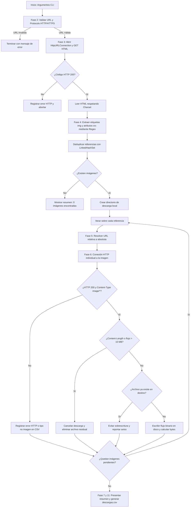

# ImageDownloader - Práctica Guiada: Descarga de Imágenes mediante URL y URLConnection en Java

[](https://openjdk.org/)
[-blue.svg)]()
[-brightgreen.svg)]()
[]()

---

## 1. Información General y Datos del Estudiante

- **Asignatura:** Desarrollo de Sistemas III
- **Unidad temática:** Arquitectura cliente-servidor y programación de aplicaciones para Internet
- **Nombre de la práctica:** Descargador de imágenes de páginas web (`ImageDownloader`)
- **Estudiante:** José Carlos Tirado Lam
- **Matrícula:** 225213509
- **Licenciatura:** Ingeniería en Sistemas de Información
- **División:** Ciencias e Ingeniería
- **Institución:** Universidad de Sonora (UNISON)
- **Entorno de desarrollo:** OpenJDK 25 (JBR 25.0.4.1), IntelliJ IDEA, Git & GitHub CLI
- **Restricción tecnológica:** Exclusivamente clases de la API estándar de Java (`java.net.URL`, `java.net.URLConnection`, `java.net.HttpURLConnection`, `java.io.*`, `java.nio.*`, `java.util.regex.*`). Queda prohibido el uso de bibliotecas de terceros (`HttpClient`, Jsoup, Apache HttpComponents, etc.).

---

## 2. Descripción del Proyecto

`ImageDownloader` es una herramienta de línea de comandos implementada en Java que reproduce fielmente el comportamiento de adquisición de recursos de un cliente web dentro de una arquitectura cliente-servidor:
1. Establece comunicación con un servidor web remoto vía HTTP/HTTPS.
2. Descarga e interpreta el documento HTML inicial identificando la codificación declarada por el servidor.
3. Analiza las etiquetas `` y extrae los atributos `src` mediante expresiones regulares y colecciones ordenadas sin duplicados.
4. Resuelve dinámicamente referencias relativas (`/imagenes/logo.png`, `../banner.jpg`) respecto a la URL base de la página.
5. Descarga cada recurso gráfico de forma binaria, validando tipos MIME (`image/*`), aplicando un límite estricto de seguridad de 10 MB, evitando sobreescrituras accidentales y limpiando archivos parciales ante fallos.
6. Admite directorio de salida configurable y genera un reporte estructurado `descargas.csv` con el estado detallado de cada transferencia.

---

## 3. Arquitectura de la Solución



### Clases Principales Utilizadas de la API Estándar

| Clase | Paquete | Responsabilidad en ImageDownloader |
|---|---|---|
| `URL` | `java.net` | Modela la localización del recurso y resuelve URLs relativas respecto a una base. |
| `URLConnection` | `java.net` | Clase base abstracta para gestionar parámetros y cabeceras de conexión. |
| `HttpURLConnection` | `java.net` | Especialización para HTTP: métodos GET, códigos de respuesta, redirecciones y cierre. |
| `InputStream` | `java.io` | Canal de lectura de bytes crudos para el documento y recursos binarios. |
| `BufferedReader` | `java.io` | Lectura eficiente por líneas de texto decodificado. |
| `Pattern` y `Matcher` | `java.util.regex` | Detección de etiquetas `` y extracción del valor en `src`. |
| `Files` y `Path` | `java.nio.file` | Creación de directorios, escritura atómica en disco y borrado de parciales. |

---

## 4. Estructura del Repositorio

```text
ImageDownloader/
├── .gitignore                      # Reglas de exclusión de binarios, carpetas de descarga y cache
├── README.md                       # Documentación técnica, reflexiones y evidencias
├── src/
│   ├── main/
│   │   └── java/
│   │       └── ImageDownloader.java       # Código fuente principal de la aplicación
│   └── test/
│       └── java/
│           └── ImageDownloaderTest.java   # Suite de pruebas automatizadas (P01-P12) con HttpServer local
└── out/                            # Clases compiladas (ignorado en Git)
```

---

## 5. Requisitos y Guía de Compilación y Ejecución

### Requisitos del Sistema
- **Java Development Kit (JDK):** Versión 17 o superior (desarrollado y probado en OpenJDK 25).
- **Git y GitHub CLI:** Para control de versiones y publicación.
- **Conexión de red:** Requerida únicamente para descargas sobre la web pública (las pruebas funcionales se ejecutan de forma local y autónoma).

### Instrucciones de Compilación

Desde la raíz del repositorio (`ImageDownloader/`):

```bash
# Crear directorio de clases compiladas
mkdir -p out/production/ImageDownloader

# Compilar la aplicación principal
javac -d out/production/ImageDownloader src/main/java/ImageDownloader.java

# Compilar la suite de pruebas funcionales
javac -cp out/production/ImageDownloader -d out/production/ImageDownloader src/test/java/ImageDownloaderTest.java
```

### Instrucciones de Ejecución

#### Uso Básico (Descarga en directorio por defecto `./imagenes`):
```bash
java -cp out/production/ImageDownloader ImageDownloader <URL>
```
*Ejemplo:*
```bash
java -cp out/production/ImageDownloader ImageDownloader https://es.wikipedia.org/wiki/Java_(lenguaje_de_programaci%C3%B3n)
```

#### Uso Avanzado (Actividad Complementaria: directorio personalizado y reporte CSV):
```bash
java -cp out/production/ImageDownloader ImageDownloader <URL> <directorio_destino>
```
*Ejemplo:*
```bash
java -cp out/production/ImageDownloader ImageDownloader https://ejemplo.org/galeria.html ./mis_descargas
```

#### Ejecución de la Suite de Pruebas Automatizadas (P01 a P12):
```bash
java -cp out/production/ImageDownloader ImageDownloaderTest
```

---

## 6. Evidencias de las Pruebas Funcionales (P01 - P12)

Se diseñó e implementó la clase `ImageDownloaderTest.java` utilizando el servidor HTTP ligero embebido de Java SE (`com.sun.net.httpserver.HttpServer`). Esto permite recrear de manera exacta y reproducible las 12 condiciones de prueba requeridas por la rúbrica sin requerir dependencias de prueba externas (como JUnit o Mockito).

### Matriz de Pruebas Funcionales

| Caso | Entrada o Condición | Resultado Esperado | Resultado Obtenido | Estado |
|:---:|---|---|---|:---:|
| **P01** | Sin argumentos en línea de comandos | Mostrar instrucciones de uso en `System.err` | Se imprime `Uso: java ImageDownloader <URL> [directorio]` y finaliza controladamente | **PASÓ** |
| **P02** | URL con sintaxis inválida (`esta_no_es_una_url_valida`) | Capturar excepción y mostrar error controlado | Se captura `IllegalArgumentException` / `MalformedURLException` con mensaje descriptivo | **PASÓ** |
| **P03** | Protocolo no admitido (`ftp://servidor.com/archivo.iso`) | Rechazar dirección no HTTP/HTTPS | Rechaza la dirección indicando `Protocolo no admitido: ftp. Solo se admiten HTTP y HTTPS.` | **PASÓ** |
| **P04** | Documento HTML sin imágenes (`/sin_imagenes.html`) | Reportar cero imágenes encontradas y terminar | Analiza el HTML e informa `Imágenes encontradas: 0`, 0 descargas | **PASÓ** |
| **P05** | URL absoluta de imagen (`http://.../img/absoluta.png`) | Resolver y descargar archivo binario correctamente | Descarga `imagen_001.png` con tamaño exacto coincidente (bytes idénticos) | **PASÓ** |
| **P06** | URL relativa de imagen (`/img/relativa.jpg`) | Resolver respecto a la URL base y descargar | Resuelve a `http://127.0.0.1:PUERTO/img/relativa.jpg` y guarda `imagen_002.jpg` | **PASÓ** |
| **P07** | Imagen duplicada en el HTML (``) | Descargar el recurso una sola vez | `LinkedHashSet` filtra el duplicado, reconociendo 1 sola referencia | **PASÓ** |
| **P08** | Imagen inexistente en servidor (HTTP 404 Not Found) | Registrar el error HTTP y continuar con las demás | Detecta código 404, notifica `ERROR (Error HTTP 404)` y continúa el bucle | **PASÓ** |
| **P09** | Recurso que no es imagen (PDF con MIME `application/pdf`) | Rechazar la descarga del recurso | Detecta Content-Type no correspondiente a `image/*`, rechaza y no crea archivo | **PASÓ** |
| **P10** | Servidor web no disponible (puerto cerrado) | Controlar excepción de conexión (`ConnectException`) | Captura `IOException` / `ConnectException` controladamente sin provocar cierre abrupto | **PASÓ** |
| **P11** | Imagen mayor al límite de 10 MB (11 MB simulados) | Cancelar descarga y eliminar archivo parcial | Aborta la transmisión al detectar el exceso y elimina cualquier archivo parcial en disco | **PASÓ** |
| **P12** | Archivo destino preexistente en el directorio local | Evitar sobrescribir el archivo existente | Detecta la preexistencia, notifica aviso y preserva intactos los datos previos | **PASÓ** |

### Registro de Salida de la Suite de Pruebas

```text
================================================================================
   EJECUCIÓN DE PRUEBAS FUNCIONALES (P01 - P12) - IMAGEDOWNLOADER
   Estudiante: José Carlos Tirado Lam | Matrícula: 225213509
================================================================================

[Servidor de Pruebas] Activo en http://127.0.0.1:61302

[P01] Sin argumentos: PASÓ (Instrucciones mostradas correctamente)
[P02] URL inválida: PASÓ (Error controlado capturado: Protocolo no admitido: null. Solo se admiten protocolos HTTP y HTTPS.)
[P03] Protocolo no admitido (ftp://): PASÓ (Rechazó protocolo ftp debidamente)
[P04] HTML sin imágenes: PASÓ (Reportó exactamente 0 imágenes)
[P05] URL absoluta de imagen: [1] absoluta.png ... OK (0,1 KB) -> imagen_001.png
      PASÓ (Descarga binaria exitosa: imagen_001.png)
[P06] URL relativa de imagen: [2] relativa.jpg ... OK (0,0 KB) -> imagen_002.jpg
      PASÓ (URL resuelta a: http://127.0.0.1:61302/img/relativa.jpg y descargada con éxito)
[P07] Imagen duplicada (Set deduplica): PASÓ (Identificó 1 sola referencia única de 2 repetidas)
[P08] Imagen inexistente (HTTP 404): [8] inexistente.png ... ERROR (Error HTTP 404)
      PASÓ (Error 404 detectado y controlado correctamente)
[P09] Recurso que no es imagen (PDF): [9] archivo.pdf ... ERROR (Rechazado: no es imagen (application/pdf))
      PASÓ (Rechazado por Content-Type no correspondiente a imagen)
[P10] Servidor no disponible (puerto cerrado): PASÓ (Excepción controlada capturada: ConnectException)
[P11] Archivo mayor al límite (11 MB > 10 MB): [11] pesada.png ... ERROR (Cancelado: supera límite de 10 MB (11 MB))
      PASÓ (Cancelado por exceder 10 MB y archivo parcial eliminado)
[P12] Archivo existente: [1] absoluta.png ... AVISO (Omitido: archivo existente (evitar sobrescritura): imagen_001.png)
      PASÓ (Sobreescritura evitada; archivo previo conservado intacto)

================================================================================
   RESUMEN FINAL DE PRUEBAS: 12 de 12 PASADAS (100%)
================================================================================
```

### Evidencia de Prueba en Producción (Wikipedia)

```text
ImageDownloader
---------------------------------------
Conectando con: https://es.wikipedia.org/wiki/Java_(lenguaje_de_programaci%C3%B3n)

Código HTTP: 200
Tipo de contenido: text/html; charset=UTF-8

Analizando documento HTML...

Imágenes encontradas: 12

[1] wikipedia.png                ... OK (13,1 KB) -> imagen_001.png
[2] wikipedia-wordmark-en.svg    ... OK (6,0 KB)  -> imagen_002.svg
[3] wikipedia-tagline-es.svg     ... OK (9,5 KB)  -> imagen_003.svg
[4] 40px-Commons-emblem-issue... ... OK (2,4 KB)  -> imagen_004.png
[5] 330px-Duke_Java_mascot...    ... OK (25,6 KB) -> imagen_005.png
[6] Java_get_powered.jpg         ... OK (12,1 KB) -> imagen_006.jpg
[7] 20px-Wikibooks-logo.svg.png  ... OK (1,3 KB)  -> imagen_007.png
[8] 20px-Wikidata-logo.svg.png   ... OK (0,4 KB)  -> imagen_008.png
[9] 20px-Commons-logo.svg.png    ... OK (1,2 KB)  -> imagen_009.png
[10] start                        ... ERROR (Rechazado: no es imagen (text/javascript; charset=utf-8))
[11] wikimedia.svg                ... OK (0,7 KB)  -> imagen_011.svg
[12] mediawiki_compact.svg        ... OK (3,4 KB)  -> imagen_012.svg

---------------------------------------
Descargas exitosas: 11
Descargas fallidas: 1
Directorio: C:\Users\chito\Documents\AgyProjects\ImageDownloader\imagenes_wiki
Reporte CSV generado exitosamente en: C:\Users\chito\Documents\AgyProjects\ImageDownloader\imagenes_wiki\descargas.csv
```

---

## 7. Reporte de Descargas (Actividad Complementaria)

Al concluir el procesamiento, la aplicación genera un archivo `descargas.csv` en el directorio de salida seleccionado con las columnas:
- `URL de imagen`: Dirección URL completa y absoluta del recurso.
- `Archivo local`: Nombre con el que se almacenó en el disco local (`imagen_001.png`, etc.) o `—` si la descarga falló o fue rechazada.
- `Estado`: Resultado de la operación (`Correcto`, `Error HTTP 404`, `Rechazado: no es imagen (...)`, `Omitido: archivo existente`, etc.).
- `Tamaño (bytes)`: Número exacto de bytes transferidos y almacenados (0 si falló).

*Fragmento representativo del archivo `descargas.csv` generado:*
```csv
URL de imagen,Archivo local,Estado,Tamaño (bytes)
"https://es.wikipedia.org/static/images/icons/wikipedia.png","imagen_001.png","Correcto",13444
"https://es.wikipedia.org/static/images/mobile/copyright/wikipedia-wordmark-en.svg","imagen_002.svg","Correcto",6170
"https://es.wikipedia.org/static/images/mobile/copyright/wikipedia-tagline-es.svg","imagen_003.svg","Correcto",9738
"https://es.wikipedia.org/beacon/event?%7B...%7D","—","Rechazado: no es imagen (text/javascript; charset=utf-8)",0
```

---

## 8. Respuestas a las Preguntas de Reflexión

### 1. ¿Qué responsabilidad desempeña la aplicación dentro de una arquitectura cliente-servidor?
La aplicación `ImageDownloader` asume estrictamente el rol de **cliente HTTP**. En la arquitectura cliente-servidor, el cliente es el agente activo que toma la iniciativa de solicitar servicios a un servidor pasivo que escucha en puertos específicos (como 80 para HTTP o 443 para HTTPS). La responsabilidad de la aplicación comprende:
- Establecer conexiones de red punto a punto hacia los servidores destino.
- Construir y transmitir solicitudes según la especificación del protocolo HTTP (método `GET`, cabeceras como `User-Agent`).
- Recibir y decodificar la respuesta del servidor (analizar códigos de estado HTTP, cabeceras MIME y juegos de caracteres).
- Procesar el documento primario (HTML) para identificar dependencias subordinadas (imágenes referenciadas).
- Orquestar solicitudes secundarias para recuperar dichos recursos y gestionarlos en el sistema de archivos del usuario local.

### 2. ¿Qué diferencias existen entre `URL`, `URLConnection` y `HttpURLConnection`?
- **`java.net.URL`:** Es un objeto inmutable que modela sintácticamente la dirección de un recurso en Internet (protocolo, usuario, host, puerto, ruta, consulta y ancla). Por sí mismo **no abre conexiones de red**, sino que sirve como descriptor y fábrica de conexiones.
- **`java.net.URLConnection`:** Es una clase abstracta que representa el enlace de comunicación bidireccional entre la aplicación Java y el recurso remoto. Proporciona una interfaz agnóstica al protocolo para consultar metadatos (`getContentType()`, `getContentLength()`), fijar tiempos de espera (`setConnectTimeout()`) y obtener flujos de entrada/salida (`getInputStream()`, `getOutputStream()`).
- **`java.net.HttpURLConnection`:** Es una subclase concreta de `URLConnection` diseñada específicamente para la semántica del protocolo HTTP/HTTPS. Expone métodos propios de HTTP como `setRequestMethod(String)` (`GET`, `POST`, etc.), `getResponseCode()`, `getResponseMessage()`, control de redirecciones (`setFollowRedirects()`) y el método `disconnect()` para liberar los sockets TCP asociados.

### 3. ¿Qué sucede al invocar `openConnection()`?
Al ejecutar `url.openConnection()`, **no se establece ninguna conexión física de red ni se transmite ningún paquete TCP por la red**. Java delega en el manejador del protocolo (`URLStreamHandler`) correspondiente al esquema de la URL para crear una instancia en memoria de `URLConnection` (o `HttpURLConnection`). En esta etapa preliminar, el socket está cerrado, lo que permite al programador configurar parámetros esenciales de la comunicación antes de abrir el enlace físico (como métodos HTTP, cabeceras personalizadas y tiempos máximos de espera).

### 4. ¿Qué operaciones provocan que la conexión se establezca realmente?
La apertura del socket TCP y el apretón de manos (handshake TCP y TLS si es HTTPS) se suscitan cuando:
- Se invoca explícitamente el método `connection.connect()`.
- O bien, de forma diferida e implícita (lazy connection), cuando se llama a cualquier método que requiera consultar o intercambiar datos con el servidor, tales como `connection.getInputStream()`, `connection.getResponseCode()`, `connection.getHeaderField()`, `connection.getContentLength()` o `connection.getOutputStream()`. Si la conexión aún no estaba establecida, estos métodos invocan internamente `connect()` antes de continuar.

### 5. ¿Por qué una página HTML puede requerir múltiples conexiones?
El documento HTML original es un recurso de texto estructurado que define la organización de la página y contiene hipervínculos hacia otros recursos externos (imágenes, archivos CSS, scripts JavaScript, fuentes). Por diseño del protocolo HTTP, cada recurso independiente cuenta con su propia URL y debe solicitarse de forma individual. El cliente debe primero descargar y parsear el archivo HTML para "descubrir" qué recursos secundarios componen la página, y posteriormente generar una conexión y solicitud HTTP por cada imagen o recurso referenciado.

### 6. ¿Cuál es la diferencia entre `getInputStream()` y `getContentType()`?
- **`getContentType()`:** Retorna una cadena de texto proveniente de la cabecera HTTP `Content-Type` enviada por el servidor (por ejemplo, `text/html; charset=UTF-8` o `image/png`). Es una operación de **metadatos** que permite inspeccionar la naturaleza del contenido antes de procesar su cuerpo.
- **`getInputStream()`:** Proporciona un canal de flujo de bytes (`InputStream`) conectado directamente al cuerpo (payload) de la respuesta HTTP, permitiendo leer secuencialmente el contenido binario o textual transferido por el servidor.

### 7. ¿Por qué distinguir recursos textuales y binarios?
- **Recursos textuales (HTML, CSS, JSON):** Están compuestos por secuencias de caracteres que representan texto legible por humanos y dependen de una codificación específica (juego de caracteres como UTF-8 o ISO-8859-1). Deben procesarse con lectores de caracteres (`Reader`, `InputStreamReader`, `BufferedReader`) para traducir correctamente secuencias de bytes en caracteres Unicode y normalizar saltos de línea según la plataforma.
- **Recursos binarios (PNG, JPEG, GIF, WEBP):** Contienen secuencias arbitrarias de bytes donde cada posición representa cabeceras del formato, coeficientes de compresión, tablas de cuantificación o datos de píxeles. Si un archivo binario se lee mediante un lector de texto, se produce una **corrupción irreversible**, ya que los decodificadores de caracteres alteran secuencias que coinciden con saltos de línea (`\r`, `\n`) y sustituyen secuencias de bytes que no corresponden a caracteres válidos por el símbolo de reemplazo `\uFFFD`. Por ello, los recursos binarios deben tratarse siempre con flujos de bytes puros (`InputStream` y `OutputStream`).

### 8. ¿Para qué sirven los tiempos máximos de conexión (`connectTimeout`) y lectura (`readTimeout`)?
Ambos tiempos de espera son salvaguardas esenciales para la estabilidad y tolerancia a fallos del software:
- **`setConnectTimeout()`:** Establece el tiempo límite que el cliente esperará a que el servidor acepte el establecimiento del socket TCP. Si el servidor está apagado, sufre saturación severa o un cortafuegos descarta silenciosamente los paquetes SYN, el cliente lanzará `SocketTimeoutException` al transcurrir el plazo, evitando que el hilo quede bloqueado durante los minutos que tarda el sistema operativo en agotar sus reintentos TCP.
- **`setReadTimeout()`:** Establece el tiempo límite admisible entre paquetes de datos una vez iniciada la transferencia. Si el servidor se cuelga en mitad del envío o la conexión de red se interrumpe abruptamente, el cliente no quedará esperando indefinidamente y podrá liberar recursos y continuar con las demás descargas.

### 9. ¿Qué limitaciones tiene analizar HTML mediante expresiones regulares?
El lenguaje HTML es una gramática libre de contexto que admite recursión, jerarquías de anidamiento complejas y marcada flexibilidad de sintaxis (atributos en cualquier orden, comillas dobles, simples o sin comillas, espacios irregulares, comentarios multilinea, entidades HTML). Las expresiones regulares (autómatas finitos deterministas) no poseen memoria de pila para validar el anidamiento correcto de etiquetas.
Entre las limitaciones prácticas más importantes se encuentran:
- Imposibilidad de discernir etiquetas `` comentadas dentro de bloques `<!--  -->`.
- Falsos positivos en fragmentos de texto o código JavaScript embebido en `<script>`.
- Dificultad para contemplar variantes sintácticas extremas o atributos complejos sin encarecer exponencialmente la expresión regular.
- **Contenido generado dinámicamente por JavaScript:** Las imágenes inyectadas en el DOM mediante scripts del lado del cliente (aplicaciones SPA, lazy loading reactivo) no están presentes en el documento HTML original recuperado por HTTP GET, por lo que son invisibles tanto para expresiones regulares como para cualquier analizador estático sin un motor de renderizado de JavaScript.

### 10. ¿Cómo podría implementarse la descarga concurrente usando únicamente la API estándar de Java?
Utilizando el paquete de concurrencia nativo `java.util.concurrent`:
1. **Grupo de hilos (`ExecutorService`):** Instanciar un grupo de hilos reutilizables mediante `Executors.newFixedThreadPool(int nHilos)` (por ejemplo, 4 u 8 hilos de trabajo).
2. **Tareas independientes (`Callable`):** Encapsular la lógica del método `descargarImagen` dentro de tareas `Callable<RegistroDescarga>`, donde cada tarea reciba su propia URL y nombre de archivo.
3. **Colecciones seguras para subprocesos:** Utilizar estructuras concurrentes como `ConcurrentLinkedQueue<RegistroDescarga>` o `CopyOnWriteArrayList` para registrar los resultados de forma atómica y sin condiciones de carrera (*race conditions*).
4. **Sincronización:** Enviar las tareas concurrentes (`executor.invokeAll(tareas)`), esperar su finalización y consolidar el reporte final.
5. **Java 21+ (Hilos Virtuales):** Con `Executors.newVirtualThreadPerTaskExecutor()`, es posible procesar cientos de descargas concurrentes con un impacto mínimo en el consumo de memoria y CPU, aprovechando que las operaciones de red son intensivas en Entrada/Salida (*I/O-bound*) y los hilos virtuales se suspenden eficientemente durante la espera del socket.

---

## 9. Historial de Commits

El desarrollo de esta práctica siguió una metodología incremental estructurada en fases, reflejada en el historial de Git:

1. `feat: estructura inicial del proyecto ImageDownloader y configuracion (Fase 1)`
2. `feat: procesamiento y validacion de argumentos y construccion de URL (Fase 2)`
3. `feat: conexion HTTP y recuperacion de documento HTML (Fase 3)`
4. `feat: integracion completa, extraccion regex, resolucion URL, descarga segura y reporte CSV (Fases 4-7 y 11)`
5. `test: suite de pruebas funcionales automatizadas P01-P12 con servidor HTTP local`
6. `docs: documentacion tecnica completa, evidencias P01-P12 y respuestas a preguntas de reflexion`

---

## 10. Conclusiones

La práctica permitió constatar experimentalmente el funcionamiento del protocolo HTTP y la arquitectura cliente-servidor desde sus fundamentos. Se comprobó cómo un cliente web opera mediante un ciclo en dos etapas: una petición inicial orientada a la recuperación del documento estructural (HTML) y múltiples peticiones subsecuentes para la descarga de recursos dependientes (imágenes). El uso riguroso de las clases `URL`, `URLConnection` y `HttpURLConnection` ilustró la importancia de diferenciar entre la representación conceptual de una dirección, la configuración de una conexión y la transmisión física de flujos binarios, aplicando en todo momento buenas prácticas de ingeniería de software como el manejo de excepciones, control de tiempos de espera, prevención de sobreescritura y liberación oportuna de recursos de red.
